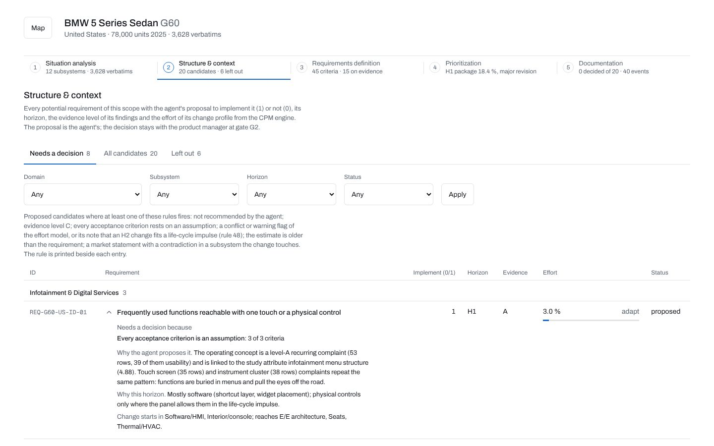
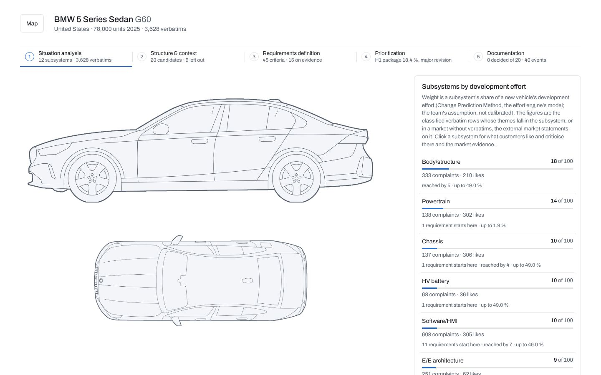
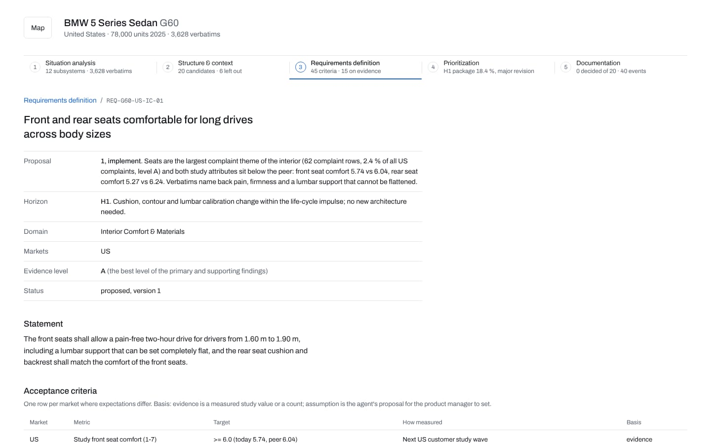
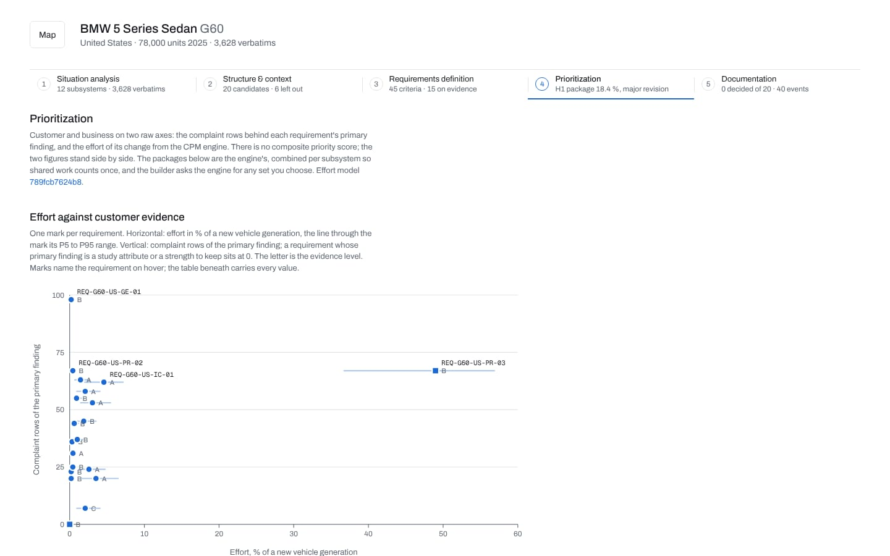
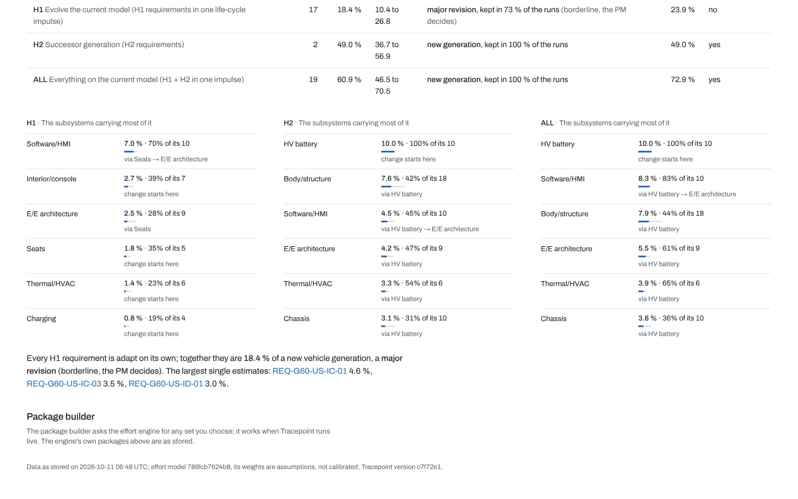

# Tracepoint

**Tracepoint helps a BMW product manager go from customer feedback to traceable, approved product requirements.**

Tracepoint is a hackathon prototype. It reads customer comments, customer studies, sales volumes, equipment catalogues, the BMW Group Report and selected external sources, and stores all of them in one PostgreSQL evidence store. From that evidence it builds findings and then concrete customer requirements. Each requirement gets an engineering effort estimate, and a product manager makes the decisions in a web workspace.

Every number on screen points back to its source (file, sheet, row, page or URL). Every decision is written to an audit log.



---

## Contents

- [Why Tracepoint](#why-tracepoint)
- [How it works](#how-it-works)
- [The product manager's workspace](#the-product-managers-workspace)
- [Scope of the prototype](#scope-of-the-prototype)
- [Quick start](#quick-start)
- [Running the frontend](#running-the-frontend)
- [Configuration](#configuration)
- [Repository layout](#repository-layout)
- [Where the data lives](#where-the-data-lives)
- [Development](#development)
- [Further documentation](#further-documentation)

---

## Why Tracepoint

Product decisions about a vehicle draw on many kinds of evidence: thousands of free-text customer comments, study scores, sales figures per market, option lists, market trends and competitor information. Usually this evidence lives in separate spreadsheets and PDFs, so it is hard to answer simple questions like:

- *What do customers in this market actually complain about, and how often?*
- *Which changes would fix it, and what would they cost in engineering effort?*
- *Who decided what, when, and based on which evidence?*

Tracepoint answers these questions in one place. It follows three principles:

1. **Evidence first.** Nothing becomes a finding or a requirement unless it has a locator back to its source.
2. **AI proposes, the PM decides.** LLM agents classify, analyse and propose. Every requirement still needs an explicit *Approve*, *Reject* or *Defer* at gate G2.
3. **Reproducible.** Scoring and effort estimates are pure functions of the stored evidence and the configuration. Re-running them gives the same result.

---

## How it works

```
 docs/ (raw inputs)            config/ (authored mappings)
   customer comments             taxonomy, vehicles, markets
   customer studies              requirements, effort model
   sales volumes                 external evidence, decisions
   option lists, Group Report
   external source lists
          │                               │
          └──────────────┬────────────────┘
                         ▼
        ┌─────────────────────────────────┐
        │ 1. Ingestion → evidence store   │  PostgreSQL, a locator on every row
        │ 2. Classification (LLM gaps)    │  canonical VFC taxonomy, blind validation
        │ 3. Findings                     │  deterministic extraction, cross-layer links
        │ 4. Requirements                 │  versioned, linked to findings and evidence
        │ 5. CPM effort engine            │  % of a new vehicle, P5–P95, subsystems
        │ 6. Analyst agents               │  briefs per vehicle × market and per series
        │ 7. Gate G2 + audit log          │  approve / reject / defer, every event logged
        └─────────────────────────────────┘
                         │
              FastAPI read API (:8000)
                         │
              Next.js workspace (:3400)
```

### Backend (`backend/`)

A Python 3.12 application built with SQLAlchemy, FastAPI, Typer and pandas.

| Module | What it does |
|---|---|
| `ingest/` | Parses the input files (customer comments, studies, sales, option lists, the Group Report page by page, external sources) into evidence rows. Each row has a locator. |
| `taxonomy/` | Builds the canonical theme structure from BMW's VFC taxonomy (level 2 / level 3) and maps it to vehicle domains. |
| `llm/` | Provider-agnostic LLM gateway (OpenAI first) with structured outputs, tool calls, pricing and per-run / per-day cost limits. |
| `classify/` | LLM classification of the rows the source files left unclassified, segmentation of notes, and blind validation against a human sample. |
| `findings/` | Deterministic extraction of findings (voice of customer, study metrics, equipment gaps) and the links between them. |
| `requirements/` | Requirement store: import, versioning, G2 decisions and the D2 requirement list export (CSV / Markdown). |
| `effort/` | CPM (Change Propagation Method) effort engine. It estimates each change as a share of a new vehicle's development effort over twelve subsystems, with P5–P95 ranges, and is back-tested against documented BMW decisions. |
| `agent/` | Context packs, drill-down tools (every call is audited) and the analyst agent loop that writes situation analyses. |
| `briefs/` | Turns agent output into plain language for the PM, with every code in words and every reference resolved. |
| `api/` | FastAPI read API (`/overview`, `/cpm/{vehicle}`, `/requirements`, `/effort/*`, `/analyses`, `/external`, `/events`, …). |

The full command list is in [`backend/README.md`](backend/README.md).

### Frontend (`frontend/`)

A Next.js 16 application (App Router, TypeScript, Tailwind CSS v4, shadcn). It shows what the backend computed and adds nothing of its own: every figure on screen comes from the backend API. The figures are either read live or from a committed snapshot under `frontend/content/`.

---

## The product manager's workspace

The PM starts on a dotted world map, picks a market (EU, US or China) and a vehicle, and then works through five stages:

| Stage | Route | What the PM sees and does |
|---|---|---|
| **1. Vehicle** | `/markets/<market>/<vehicle>` | A technical sketch of the car next to its twelve CPM subsystems. Each subsystem opens a dialog with what customers like, what they criticise, the market evidence and the requirements that change it. Links lead to the series across its regions and to the external market evidence. |
| **2. Structure & context** | `…/structure` | The analyst's brief, followed by every potential requirement with the agent's proposal, filters and the effort of each change. |
| **3. Requirements** | `…/requirements/<id>` | One requirement with its acceptance criteria, evidence (customer comments as written), assumptions, CPM effort, history and the gate G2 controls. |
| **4. Prioritization** | `…/priorities` | Customer evidence and effort side by side, the engine's H1 / H2 / ALL packages, a package builder and the CPM method sheet. |
| **5. Documentation** | `…/log` | The decision record, the audit trail and the requirement list as CSV and Markdown. |

| | |
|---|---|
|  |  |
| *Stage 1: vehicle and CPM subsystems* | *Stage 3: a requirement with evidence and effort* |
|  |  |
| *Stage 4: evidence vs. effort* | *Stage 4: package builder* |

More screenshots are in [`frontend/docs/screenshots/`](frontend/docs/screenshots/).

---

## Scope of the prototype

| Vehicle | Code | Markets in the workspace |
|---|---|---|
| BMW 1 Series | F70 | EU |
| BMW 5 Series Sedan | G60 | EU, US |
| BMW 5 Series Long Wheelbase | G68 | CN |
| BMW 7 Series | G70 | EU, US, CN |

Requirements are currently authored for G60 / US, G70 / US and F70 / EU (`config/requirements/`). Markets follow the sales file: Europe, USA (North America, including Canada), China and Rest of World.

---

## Quick start

**Prerequisites:** Docker Desktop (or Docker Engine / Podman) and an internet connection. [`uv`](https://docs.astral.sh/uv/) is installed automatically if it is missing.

```bash
git clone <this repository> tracepoint
cd tracepoint
./start.sh            # macOS / Linux / WSL
.\start.ps1           # Windows PowerShell
```

The script is idempotent, so it is safe to run again. It runs eight steps:

1. Checks the prerequisites (`uv`, Docker, compose).
2. Starts PostgreSQL 16 in Docker (persistent volume `tracepoint-pgdata`).
3. Creates `.env` from `.env.example`.
4. Installs the backend dependencies.
5. Creates the schema, builds the taxonomy and ingests the files under `docs/`.
6. Extracts findings for four vehicle × market scopes and writes fresh reports to `data/reports/`. The committed samples under `reports/` are not changed.
7. Runs the test suite.
8. Optionally runs the LLM steps.

| Option | Effect |
|---|---|
| `--reset` / `-Reset` | Drop the database volume and rebuild everything |
| `--no-docker` | Use a PostgreSQL that is already running on `localhost:$TRACEPOINT_PG_PORT` (role `tracepoint`, databases `tracepoint` and `tracepoint_test`) |
| `--with-llm` / `-WithLlm` | Run a 50-comment classifier validation per vehicle (needs the OpenAI key in `.env`) |
| `--llm-full` | Full validation, gap classification and segmentation (costs tokens) |
| `--skip-tests` / `-SkipTests` | Skip pytest |
| `--api` / `-Api` | Start the read API on <http://localhost:8000/docs> at the end |

> **Port 5432 taken?** Run `export TRACEPOINT_PG_PORT=5433` before starting.
>
> **Podman instead of Docker** (e.g. Fedora): run `systemctl --user enable --now podman.socket`, then `export DOCKER_HOST=unix:///run/user/$UID/podman/podman.sock` before `./start.sh`.

### After the start

```bash
cd backend
uv run tracepoint status                                   # table counts and last runs
uv run uvicorn tracepoint.api.app:app --reload             # API docs on http://localhost:8000/docs
uv run tracepoint requirements export                      # requirement list (CSV + Markdown)
uv run tracepoint effort estimate                          # CPM effort of every requirement
uv run tracepoint agent analyze --vehicle G60 --market US  # analyst brief (needs the OpenAI key)
scripts/db-dump.sh                                         # back up to backups/
scripts/db-restore.sh backups/<file>.dump                  # restore
```

---

## Running the frontend

Requires Node 22 and pnpm.

```bash
# terminal 1: backend API
./start.sh --api                 # or: cd backend && uv run uvicorn tracepoint.api.app:app --port 8000

# terminal 2: web app
cd frontend
pnpm install
pnpm build && pnpm start         # http://localhost:3400   (or `pnpm dev` while developing)
```

The app switches to **live mode** automatically whenever the backend answers. Approve, Reject and Defer on a requirement page then record a real decision through `POST /requirements/{id}/decision`. Without the backend, the app shows the committed snapshot and disables the decision controls.

| Variable | Default | Effect |
|---|---|---|
| `TRACEPOINT_LIVE` | unset | Unset: live when the API answers. `1`: always live. `0`: stored data only. |
| `TRACEPOINT_API_URL` | `http://127.0.0.1:8000` | Where the Next.js server finds the backend |

`pnpm snapshot` refreshes `frontend/content/` from a running backend. See [`frontend/README.md`](frontend/README.md) for all commands, including the page audit and the screenshot tool.

---

## Configuration

Settings are read from environment variables with the `TRACEPOINT_` prefix, or from a `.env` file at the repository root. Copy [`.env.example`](.env.example) to get started. All variables are optional.

| Variable | Purpose |
|---|---|
| `TRACEPOINT_DATABASE_URL`, `TRACEPOINT_TEST_DATABASE_URL` | Application and test databases |
| `TRACEPOINT_OPENAI_API_KEY` | Needed only for the LLM steps (classification, validation, analyst agents) |
| `TRACEPOINT_OPENAI_MODEL`, `TRACEPOINT_OPENAI_MODEL_BULK` | Reasoning model and the cheaper bulk model |
| `TRACEPOINT_LLM_MAX_COST_USD_PER_RUN`, `…_PER_DAY` | Spending limits for LLM runs |

Everything except the LLM steps works **without an API key**. LLM commands support `--dry-run`, which prints the prompts and a token estimate. The committed classification labels in `config/classifications/` are applied without any API call.

---

## Repository layout

```
backend/     Python backend: ingestion, taxonomy, LLM gateway, findings, requirements,
             CPM effort engine, agents, FastAPI read API, Typer CLI, pytest suite
frontend/    Next.js workspace: landing map, vehicle screen, the five stages
config/      Authored inputs: vehicles, markets, taxonomy, requirements, effort model and
             anchors, CPM mappings, external evidence, classification labels, G2 decisions
docs/        Raw input files (read-only): customer feedback, studies, sales, option lists,
             BMW Group Report, external source lists
plan/        Master plan, phase plans and the decision log (plan/decisions.md)
reports/     One report per step, plus committed sample outputs (baseline, findings,
             requirements, effort, analysis, validation)
scripts/     Database backup and restore
backups/     Target folder for database dumps
start.sh     One-command local start (start.ps1 for Windows)
Makefile     Shortcuts for setup, database, ingestion, tests, lint and API
```

---

## Where the data lives

The database is **derived, never the source of truth**. Running `./start.sh --reset` on any machine rebuilds it from:

- `docs/`: the raw inputs,
- `config/`: the authored mappings, requirements and effort model,
- `config/classifications/*_gaps.jsonl`: labels for the rows the source files left unclassified,
- `config/decisions/requirements.jsonl`: the gate G2 decisions. The file is created by the first decision and replayed on every import.

Anything that must survive a rebuild therefore has to be committed as a file under `config/`.

Evidence is referenced with stable strings such as `verbatim:G60-0123`, `metric:MET-US-US-G60-voice_recognition`, `equipment:EQ-F70-0112` or `document:DOC-GROUP-REPORT-0079`. Each of these resolves to a locator in its source file.

---

## Development

```bash
make setup     # uv sync with dev dependencies
make test      # pytest against tracepoint_test
make lint      # ruff check + format check
make format    # ruff format
make api       # API on :8000 with reload

cd frontend && pnpm check   # lint, typecheck, vitest and build
```

CI (`.github/workflows/ci.yml`) runs the backend lint and test suite against PostgreSQL 16 on every pull request.

**Conventions:** English everywhere. One report per step under `reports/`. Decisions are recorded in `plan/decisions.md`. The frontend rules in `frontend/docs/02-forbidden-list.md` are checked before every delivery.

---

## Further documentation

| Document | Content |
|---|---|
| [`plan/00-master-plan.md`](plan/00-master-plan.md) | Vision, principles, vocabulary and phases |
| [`plan/decisions.md`](plan/decisions.md) | Decision log (D-xxx) |
| [`backend/README.md`](backend/README.md) | Every CLI command and API endpoint |
| [`frontend/README.md`](frontend/README.md) | Frontend commands, live mode, layout |
| [`frontend/docs/README.md`](frontend/docs/README.md) | Design notes and screen specifications |
| [`reports/`](reports/) | Step-by-step reports and sample outputs |

---

*Tracepoint is a hackathon prototype built on BMW-provided sample data. It is not an official BMW product.*
